<div align="center">



<br />

<a href="https://github.com/erfand39?tab=repositories"></a>
<a href="https://github.com/erfand39?tab=overview"></a>
<a href="https://instagram.com/er.dehghani"></a>
<a href="https://github.com/erfand39?tab=followers"></a>

<br /><br />

**Software Engineer & Product Builder** · Crafting elegant web, desktop & PWA experiences.

<sub>طراحی تجربه‌های کاربری دقیق، توسعهٔ نرم‌افزارهای کاربردی و ساخت سامانه‌هایی که استفاده از آن‌ها لذت‌بخش باشد.</sub>

<br /><br />



</div>

## ◈ Selected work

> Four different problems. One principle: **make complex workflows feel simple.**

<div align="center">
  <a href="https://github.com/erfand39/tennis-club-os"></a>
  <a href="https://github.com/erfand39/pulse-mac"></a>
  <a href="https://github.com/erfand39/Aban-Cafe"></a>
  <a href="https://github.com/erfand39/amir-system"></a>
</div>

<details>
<summary><strong>↳ Explore the projects in more detail</strong></summary>
<br />

| Project | What it solves | Core technologies |
|:--|:--|:--|
| [**Sam Tennis**](https://github.com/erfand39/tennis-club-os) 🎾 | Courts, bookings, coaches, attendance, finance and operational reporting in a Persian-first management experience. | Next.js · TypeScript · PostgreSQL · Docker |
| [**Pulse Mac**](https://github.com/erfand39/pulse-mac) ⚡ | Download queue, multi-connection transfers, recovery and macOS-specific ergonomics for Apple Silicon. | Electron · React · TypeScript |
| [**Aban Café**](https://github.com/erfand39/Aban-Cafe) ☕ | Recipe-level food costing, sale prices and a lightweight local ledger. | React · TypeScript · SQLite · Python |
| [**Amir System**](https://github.com/erfand39/amir-system) 🔊 | Car-audio discovery, checkout, inventory, fulfillment and order lifecycle. | PHP · MariaDB/MySQL · PWA |

</details>

## ◈ The toolkit

<div align="center">
  
</div>

## ◈ How I approach the build

```text
01 / UNDERSTAND     Find the real workflow, not just the feature list.
02 / DESIGN         Make the interface quiet, clear, and intentional.
03 / ENGINEER       Treat reliability, data integrity, and speed as features.
04 / REFINE         Test the edge cases. Polish the small interactions.
05 / SHIP           Document it. Make it usable. Keep improving it.
```

<table>
  <tr>
    <td width="50%" valign="top">
      <h3>✳ Product experience</h3>
      Accessible interfaces, Persian/RTL UX, responsive layouts, thoughtful information architecture, and visual consistency.
    </td>
    <td width="50%" valign="top">
      <h3>⌘ Systems engineering</h3>
      Full-stack architecture, local-first software, database integrity, repeatable deployments, performance, and maintainability.
    </td>
  </tr>
</table>

## ◈ Let's connect

I'm always interested in interesting engineering challenges, elegant products, and useful open-source software. The best way to connect is through the work.

<div align="center">

<a href="https://github.com/erfand39?tab=repositories"></a>
<a href="https://github.com/erfand39"></a>
<a href="https://instagram.com/er.dehghani"></a>

<br /><br />


<sub>Designed specifically for <a href="https://github.com/erfand39">@erfand39</a> · All illustrations are original, self-hosted SVG assets · Reduced-motion friendly</sub>

</div>
