  <picture>
    <source media="(prefers-color-scheme: dark)" srcset="https://readme-typing-svg.demolab.com?font=Fira+Code&amp;weight=600&amp;size=21&amp;duration=3100&amp;pause=1000&amp;color=62F1E4&amp;center=true&amp;vCenter=true&amp;width=760&amp;height=60&amp;lines=Building+thoughtful+open-source+tools;Desktop+apps+%C2%B7+Web+platforms+%C2%B7+PWA;Making+complex+workflows+feel+simple;Always+learning.+Always+building." />
    
  </picture>

  
  
  

  <a href="#-about-me">About</a> &nbsp;·&nbsp;
  <a href="#-tech-stack">Tech Stack</a> &nbsp;·&nbsp;
  <a href="#-featured-projects">Projects</a> &nbsp;·&nbsp;
  <a href="#-github-analytics">Analytics</a> &nbsp;·&nbsp;
  <a href="#-lets-connect">Connect</a>

---

## 👋 About Me

<table>
<tr>
<td width="59%" valign="top">

I'm **Erfan Dehghani**, a software developer who loves making useful tools feel intuitive. I work across **desktop applications, modern web platforms, Persian-first interfaces, and local-first systems**.

- 🔭 Building **productivity tools, management platforms, and practical utilities**
- 🧩 Focused on **clean UI/UX**, **data integrity**, and **software reliability**
- 💻 Working with **TypeScript, React, Next.js, Electron, Python, and PHP**
- 🗄️ Designing solutions with **PostgreSQL, SQLite, and MariaDB**
- 🍎 Enjoy building for **macOS and Apple Silicon**
- 🌐 Crafting accessible, responsive, **Persian / RTL** experiences
- ✨ My principle: **Make it work. Make it matter.**

طراحی و توسعهٔ ابزارهای کاربردی، از ایده و معماری تا تجربهٔ کاربری و اجرای قابل‌اعتماد.

</td>
<td width="41%" valign="middle">
  
</td>
</tr>
</table>

---

## 🛠️ Tech Stack

**Languages**

 

**Frameworks &amp; Platforms**

 

**Databases &amp; Tools**

---

## 🚀 Featured Projects

A selection of products I've built and refined. Explore more in <a href="https://github.com/erfand39?tab=repositories"><b>my repositories</b></a>.

<table>
<tr>
<td width="50%" align="center">

<a href="https://github.com/erfand39/pulse-mac"><b>⚡ Pulse Mac</b></a> Downloads, queues, resuming &amp; Apple Silicon
</td>
<td width="50%" align="center">

<a href="https://github.com/erfand39/tennis-club-os"><b>🎾 Sam Tennis Club</b></a> Courts, bookings, coaching &amp; operations
</td>
</tr>
<tr>
<td width="50%" align="center">

<a href="https://github.com/erfand39/Aban-Cafe"><b>☕ Aban Café</b></a> Recipe costing, pricing &amp; local ledger
</td>
<td width="50%" align="center">

<a href="https://github.com/erfand39/amir-system"><b>🔊 Amir System</b></a> Car-audio commerce, inventory &amp; orders
</td>
</tr>
</table>

<b>🎨 Open the custom-designed project showcase</b>

 

  
  
  
  

---

## 📊 GitHub Analytics

  
  

  

  

Statistics are generated from publicly available GitHub activity by third-party image services and may be cached or temporarily unavailable.

---

## ✨ How I Build

  

| 01 — Understand | 02 — Design | 03 — Engineer | 04 — Refine |
|:---:|:---:|:---:|:---:|
| Solve the real problem | Keep interfaces intentional | Build for reliability | Polish the small details |

---

## 💬 A Little Inspiration

<i>“Good software is in the details. Keep building.”</i>

---

## 🤝 Let's Connect

  

Handcrafted for <a href="https://github.com/erfand39"><b>@erfand39</b></a> · Original local SVG illustrations · GitHub-friendly Markdown

